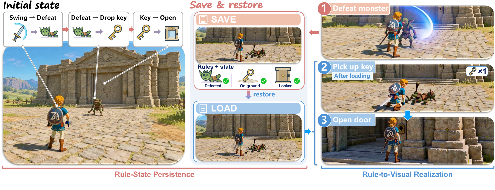

# WorldRuler: Interactive World Modeling under Configurable Rules

WorldRuler enables interactive world modeling under configurable rules. It connects an executable 3D rule graph with video generation and perceptual feedback to preserve object states and rule dependencies across interactions. Dynamic object binding grounds symbolic entities in visual instances, while attribute replacement translates rule outcomes into targeted visual changes. We also introduce RuleVerse, a paired dataset collected in Habitat and GTA-V for studying rule-conditioned world evolution.



## Open-source Plan

- [x] [Project page](https://alaya-lab.github.io/WorldRuler/)
- [x] [Technical report](https://arxiv.org/abs/2611.24869)
- [ ] Inference code
- [ ] [Dataset](https://huggingface.co/datasets/AlayaLab/RuleVerse)
- [ ] [Models](https://huggingface.co/AlayaLab/WorldRuler)

## Citation

```bibtex
@article{zhai2026worldruler,
  title={WorldRuler: Interactive World Modeling under Configurable Rules},
  author={Mingliang Zhai and Chuanhao Li and Jiaming Tan and Zhen Li and Yuwei Wu and Yunde Jia and Zian Meng and Yuanyang Yin and Kaipeng Zhang},
  journal={arXiv preprint arXiv:2611.24869},
  year={2026}
}
```
